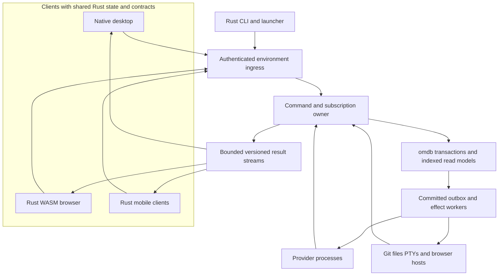

# Full-system Rust architecture

This design uses the researched upstream snapshot `28706aceb6fb3babf2cbae0dc0c3edd93b9b6d5f`. The [implementation plan](IMPLEMENTATION.md) turns it into dependency-ordered work. [Current state](CURRENT-STATE.md) distinguishes the integrated fork, this research snapshot and newer detected upstream. Candidate toolkit and engine choices require the acceptance gates below; this document does not change production selection.

The destination for t3code-ls is a complete Rust implementation of the T3 product: desktop, browser, mobile, CLI, environment server, provider control, workspace services, remote access, and the services that connect them. Performance must be assessed from the user's action to the usable result. A storage-engine benchmark answers only one part of that question.

The recommended design is a shared Rust domain and client-state core, a native desktop presentation layer, a Rust/WASM browser client, dedicated mobile platform integrations, and one Rust environment owner for commands, persistence and execution. The first performance implementation should span a complete streaming conversation and history journey. Qualify Fjall and direct redb behind omdb within that architecture. The earlier [database research](research/database/report.md) remains a storage appendix; it does not select the architecture of the entire product.

# Baseline and completion criteria

The behavior and performance baseline is stock [pingdotgg/t3code at 28706aceb6fb3babf2cbae0dc0c3edd93b9b6d5f](https://github.com/pingdotgg/t3code/tree/28706aceb6fb3babf2cbae0dc0c3edd93b9b6d5f). Current t3code-ls performance is not the denominator. The fork's [AGENTS.md at 3577878](https://github.com/glopyglerky/t3code-ls/blob/3577878a5e008c8af87a8fbdae13d26dea1c2f50/AGENTS.md) supplies migration constraints: one functioning application, retained public contracts, omdb as the native authoritative store, no uncertain mutation retried through a fallback, and retirement only for accepted platform scope.

The source inventory identifies 247 declared RPC methods, including 31 streaming methods, 59 typed HTTP endpoints, 58 public orchestration command variants, 16 internal command variants, and 49 domain event variants. The server map assigns every declared RPC to one of 27 capability families, and inventories 93 MCP tool declarations in 15 toolkits. These are lexical contract counts, not a runtime certification. MCP, uploads/assets, speech, preview/device streams, guests and peer links add direct HTTP surfaces outside the typed HTTP group. The evidence bundle retains the enumerated names and their pinned source locations. [RPC contracts](https://github.com/pingdotgg/t3code/blob/28706aceb6fb3babf2cbae0dc0c3edd93b9b6d5f/packages/contracts/src/rpc.ts), [HTTP contracts](https://github.com/pingdotgg/t3code/blob/28706aceb6fb3babf2cbae0dc0c3edd93b9b6d5f/packages/contracts/src/environmentHttp.ts), [orchestration contracts](https://github.com/pingdotgg/t3code/blob/28706aceb6fb3babf2cbae0dc0c3edd93b9b6d5f/packages/contracts/src/orchestrationV2.ts).

Acceptance requires three separate facts: the user outcome is preserved; its normal production path runs through the intended Rust owner; and it meets the performance and failure criteria on each affected platform. A component test, a Rust source percentage, or an API demo establishes none of these by itself.

There are also three distinct language boundaries. T3-owned behavior is the Rust port target. Browser engines, operating systems and provider executables are external hosts with explicit interfaces. Native third-party dependencies and generated platform glue need their own inventory. A Rust binding to C, a WebView, or a generated JavaScript loader does not establish a pure-Rust dependency graph or whole-process memory safety. Handwritten TypeScript, Swift or Kotlin that still implements a T3 feature remains unfinished port scope.

# The product that must be preserved

Upstream places execution on the environment that owns the workspace. A phone or remote desktop controls that environment; it never substitutes its own files or provider credentials. Its [architecture](https://github.com/pingdotgg/t3code/blob/28706aceb6fb3babf2cbae0dc0c3edd93b9b6d5f/docs/internals/overview.md), [remote model](https://github.com/pingdotgg/t3code/blob/28706aceb6fb3babf2cbae0dc0c3edd93b9b6d5f/docs/internals/remote.md), and [user documentation](https://github.com/pingdotgg/t3code/tree/28706aceb6fb3babf2cbae0dc0c3edd93b9b6d5f/docs/user) define the following ownership map.

| User capability | Rust implementation owner | Completion requirement |
|---|---|---|
| Projects, multi-repository workspaces, threads, forks, side chats, attachments and history | Shared domain types; environment command engine; client read models | Preserve ordering, ancestry, visibility, pagination, selection and deep links |
| Streaming chat, markdown, code, diffs, composer chips and queued input | Shared text/state core; platform presentation and input | Stable scrolling and editing while output arrives; correct Unicode, IME, accessibility and cancellation |
| Provider install, sign-in, models, accounts, limits and sessions | Provider registry and per-instance Rust drivers | All upstream provider families and their supported/refused operations; isolated accounts and provider homes |
| Approvals, questions, secrets, goals, delegation, handoffs, plans and background tasks | Domain command engine and durable effect workers | Preserve permission ceilings, call identity, restart behavior and effect ownership |
| MCP and outside agents | Rust MCP service and explicit access declarations | Tool discovery and execution authorization agree; thread credentials and external clients remain distinct |
| Scheduled work and webhooks | Environment scheduler/inbox; Rust Connect services | Recurrence, timezone/DST, deduplication, leases, offline holding and replay policy |
| Files, search, Git, worktrees, checkpoints, rollback and PR flows | Environment workspace services | Real repository/filter/hook/credential/conflict semantics and multi-folder recovery |
| Interactive terminal | Host PTY owner; client terminal engine and platform input/rendering | Byte ordering, reconnect, retained output, terminal queries, Unicode, paste and resize |
| Browser previews, visual HTML replies and MCP apps | Isolated browser hosts managed by Rust | Real website execution, sandbox boundaries, profiles/session import, passkeys and remote routing |
| Device/simulator/emulator control and streamed media | Environment device services and native platform adapters | Device lifecycle, remote control, authorization, input and video/audio behavior |
| Multiple environments, LAN, Tailscale, SSH, Connect and linked environments | Shared connection supervisor; environment identity/auth; transport adapters | Route changes preserve identity, authority, subscriptions and mutation semantics |
| Guest sharing and read-only remote threads | Dedicated Rust guest/peer services | Thread-scoped grants, revocation, proposal workflow and no escalation to general RPC |
| Mobile offline use, speech, push, widgets and Live Activities | Shared Rust state plus iOS/Android integrations | Durable drafts/outbox, secure keys, resume, audio interruption, notification action and extension lifecycle |
| CLI, background services and headless operation | Rust command frontend and launcher | Existing commands, scripting results, process ownership, SSH/WSL behavior and local-server-disabled desktop mode |
| Installation, downloads, updates, migration, backup and recovery | Rust release/launcher/update owners | Signed artifacts, platform packaging, activation fencing, compatible rollback and interrupted-update recovery |
| Hosted web, Connect sign-in, landing/download pages and user help | Rust-authored web/site services and retained content | Existing entry links, account handoff, downloads and documentation remain usable |

The detailed client and server appendices map these families to production entry points. They are a parity ledger, not a claim that every implementation branch has been individually reviewed. The client map includes 30 capability families, including document/media viewers, SnapShot, PR/issue review, desktop shell integration, settings and support surfaces.

The marketing/download site already produces static HTML. Preserve that property with Rust-generated HTML and progressive controls; making every landing page wait for a WASM application would add cost. Installation scripts, asset formats and documentation remain deliverables even where source text is not Rust. The CLI also has behavioral contracts beyond command names: stdout versus stderr, JSON output on failure, stdin input, exit codes, TTY/color handling and private SSH helper messages. [Marketing layout](https://github.com/pingdotgg/t3code/blob/28706aceb6fb3babf2cbae0dc0c3edd93b9b6d5f/apps/marketing/src/layouts/Layout.astro), [thread CLI](https://github.com/pingdotgg/t3code/blob/28706aceb6fb3babf2cbae0dc0c3edd93b9b6d5f/apps/server/src/cli/thread.ts).

# A coherent Rust architecture

Use a small number of real execution owners. One environment daemon owns its durable state and execution decisions. Native clients, browser clients and the CLI call domain operations. Provider processes and browser hosts remain isolated where their lifetime and trust boundaries require it. A process per database call, a JSON bridge per SQL statement, or duplicate business algorithms in client adapters would recreate avoidable overhead.



The shared core is a library embedded in each appropriate process, not another network service. Keep domain types and selected view models independent of GPUI, Dioxus, a database crate and transport-specific connection objects. Put Rust modules under their owning applications/packages, following the repository's source map.

## Environment execution

Use a Rust asynchronous runtime for network and process coordination, with bounded CPU/I/O workers for parsing, filesystem operations, diffing and other blocking work. The important choice is scheduling discipline: CPU work must not block socket progress or UI presentation, and maintenance must not starve interactive commands. More tasks and threads are not automatically faster.

Keep command decisions deterministic and external I/O outside database transactions. Commit events, authoritative projections, command receipts, indexes and durable outbox intent atomically; acknowledge accepted intent after commit; execute external effects afterward. Preserve rollback of a failed job inside a coalesced batch. Reads use immutable committed snapshots or explicit read transactions. Do not publish uncommitted state as durable state. These are existing upstream semantics, so they are mandatory in a faster design. [EventSink](https://github.com/pingdotgg/t3code/blob/28706aceb6fb3babf2cbae0dc0c3edd93b9b6d5f/apps/server/src/orchestration-v2/EventSink.ts), [EffectWorker](https://github.com/pingdotgg/t3code/blob/28706aceb6fb3babf2cbae0dc0c3edd93b9b6d5f/apps/server/src/orchestration-v2/EffectWorker.ts).

Parallelize independent preparation, reads, provider I/O and repository work while retaining ordered state publication and the correct transaction owner. Per-thread queues can prevent unrelated work from monopolizing admission, but cross-thread commands, shared project state and global event sequencing still need explicit coordination. Do not assume independent-looking threads permit independent commits.

## Client state

Port the current shared connection/state owner into Rust once. Each environment has one reconnect supervisor, credential authority, cache generation and subscription owner. UI views select slices of state; they do not run competing retry loops or independently reconstruct the same thread.

Preserve the existing distinction between a connected transport and fresh shell/thread data. Cache a state revision and its replay cursor together. A cancelled or obsolete scope must not advance a cursor past applied data or overwrite its successor. Keep the offline view readable without presenting it as current. Upstream already shares subscriptions, retains idle thread state, starts shell HTTP loading early, handles route preference, and treats mobile suspension specially. These behaviors belong in the baseline. [Connection runtime](https://github.com/pingdotgg/t3code/blob/28706aceb6fb3babf2cbae0dc0c3edd93b9b6d5f/docs/internals/connection-runtime.md).

Use stable IDs, compact typed records and immutable revisions for cross-task readers. An owner-local mutable builder can accumulate a stream; publish bounded immutable changes at the commit/render boundary. Avoid cloning complete collections to change one item. Sharing a Rust type is useful; making every module depend on one huge mutable application object is not.

# Where the design can remove more work than upstream

These are source-supported optimization hypotheses. They identify mechanisms and affected user journeys; they do not claim an unmeasured multiplier.

## 1. Make streaming incremental across the entire pipeline

The pinned ProviderTextDeltaCoalescer clones its active-message map on append, retains accumulated text, and emits the full current prefix when draining. In the Codex path, those outputs feed node and turn-item snapshots; the message update is completed separately, so this is not evidence that every token produces duplicate completed-message persistence. LiveStreamBudget also serializes an immutable event to determine its byte size, caching that size in a WeakMap; transport encoding is another step. [Coalescer](https://github.com/pingdotgg/t3code/blob/28706aceb6fb3babf2cbae0dc0c3edd93b9b6d5f/apps/server/src/orchestration-v2/Adapters/ProviderTextDeltaCoalescer.ts), [Codex adapter](https://github.com/pingdotgg/t3code/blob/28706aceb6fb3babf2cbae0dc0c3edd93b9b6d5f/apps/server/src/orchestration-v2/Adapters/CodexAdapterV2.ts), [stream budget](https://github.com/pingdotgg/t3code/blob/28706aceb6fb3babf2cbae0dc0c3edd93b9b6d5f/apps/server/src/orchestration-v2/LiveStreamBudget.ts).

For a message delivered in m emitted coalesced updates, each adding c bytes, encoding every full prefix requires:

```math
\sum_{i=1}^{m} i c = \frac{c\,m(m+1)}{2}.
```

Encoding each addition once requires cm bytes plus framing, occasional snapshots and any actual replacements. This is a statement about representations and emitted bytes, not an assertion that JavaScript eagerly copies every concatenated character or that every provider follows this path.

The Rust design should maintain chunked text with an item revision; persist new chunks and the authoritative item header in the same commit; expose append/replace/splice operations as appropriate; encode each negotiated, authorization-filtered event representation once; and reuse that immutable encoding for equivalent subscribers. The client applies the change to the matching base revision and invalidates only affected text/layout blocks.

The storage gain requires changing any durable event/outbox representation that currently retains the full prefix, not merely adding a chunk table beside it. Version the internal event format and qualify projection application, retained-anchor dependencies, snapshot construction, pruning and restart replay. If compatibility contracts require a full-prefix record to remain on a path, count that work honestly. The strongest asymptotic gain applies to the new representation end to end.

Full replacements remain necessary for provider corrections, finalized text that differs from the accumulated stream, edits and resynchronization. Snapshots must reconstruct the exact authoritative state after event pruning. Bound retained chunks and encoded versions; a slow subscriber must not pin every historical full prefix. Preserve receipts and cancellation ordering.

Keep the current JSON protocol for existing clients. Introduce compact revisioned deltas only through an advertised capability/version, with defined missing-base recovery. This gives two independently measurable stages: less internal allocation/encoding with unchanged wire behavior, then lower end-to-end work with Rust clients using the new representation. Do not silently change a public message schema.

## 2. Fetch and render the requested history window

Upstream already bounds ordinary history pages and payload bytes, materializes some counts/inline output, and virtualizes the timeline. The remaining full-index paths include fork ancestry, some jumps and cursor fallbacks, and in-thread find. The store appendix specifies counted order structures, ancestry/visibility rules and exact search semantics; port those into a domain API that returns precisely the visible window and its anchors.

Rust clients should consume that window directly, retain compact headers for navigation, and fetch large item payloads on demand. A history optimization wins only when it reduces storage reads, encoding, transport, state allocation and layout together. A quicker database page followed by rebuilding the entire transcript is a poor end-to-end arrangement. [History design and operation evidence](research/database/report.md).

Do not flatten fork history or drop superseded/cancelled evidence. Do not replace exact T3 search ranking with a generic BM25 or fuzzy score. The current candidate caps, visibility, Unicode offsets and ranking rules are part of the behavioral comparison.

## 3. Remove expensive boundaries without destroying isolation

Decode provider frames once into typed Rust events. Keep parsing, normalization, command preparation and storage calls inside their owning Rust process. Cross a process boundary for a provider/browser lifetime or a client connection, not for every tiny database operation. A native desktop can use local IPC while retaining the same authority and domain contract; remote clients use network transport.

At each actual boundary, record bytes copied, encodings, allocations, queue delay and CPU time. An Arc or a borrowed byte slice can avoid an internal copy; it does not remove browser/WASM, kernel, TLS or GPU transfers. Choose compact binary encoding only after semantic compatibility is explicit. Validation remains required at untrusted boundaries.

## 4. Keep interactive work ahead of bulk work

Separate command/approval traffic, durable result streams, terminal traffic and bulk media/file transfers into independently budgeted queues. Flow-control subscriptions by acknowledged sequence and bytes, with an explicit resnapshot on overflow. Preserve lossless terminal semantics and durable domain changes; coalesce only data whose contract permits it.

Upstream already has provider commit batching, fairness, bounded live buffers, ACK-aware retention and live event coalescing. The proposed gain is coordination across the whole path, including client rendering and transport, rather than adding batching for the first time. A fixed large batch can improve throughput while making approval and typing latency worse. [Thread live coalescer](https://github.com/pingdotgg/t3code/blob/28706aceb6fb3babf2cbae0dc0c3edd93b9b6d5f/apps/server/src/orchestration-v2/ThreadLiveEventCoalescer.ts).

## 5. Eliminate search and workspace stalls at their owner

WorkspaceSearchIndex explicitly documents that its native fff picker's watcher can hold a search lock for minutes. Upstream already uses asynchronous APIs so this does not block the JavaScript thread. The architectural opportunity is immutable published search generations, short update locks, cancellation of obsolete queries and background index construction. Use structurally shared or segmented indexes, bounded retained generations and bounded reader lifetimes; cloning the entire index on each update would replace a lock problem with a memory/CPU problem. Replacing the JavaScript wrapper alone does not solve a lock inside the native engine. [WorkspaceSearchIndex](https://github.com/pingdotgg/t3code/blob/28706aceb6fb3babf2cbae0dc0c3edd93b9b6d5f/apps/server/src/workspace/WorkspaceSearchIndex.ts).

Reuse repository handles, object/config caches, ignore evaluation and shared scans. Coordinate Git status, search refreshes and checkpoints without letting one consumer's cache become another consumer's stale authority. Watchers are invalidation hints: overflow, external edits, mounted filesystems and missed events require reconciliation. Skip a checkpoint scan only when the implementation can establish the required unchanged state; the absence of a watcher event is not proof.

## 6. Give desktop presentation a native design

Use GPUI as the first desktop performance candidate, with shared Rust view models, stable row identities, bounded virtualized lists and explicit dirty regions. Separate parsing, syntax, diff computation and filesystem work from UI presentation. Keep actual website/MCP content in an isolated browser host, which can start when that feature is needed. GPUI does not automatically supply that embedded browser. Prove in-window composition, focus/input routing, profiles, passkeys, media and sandboxed MCP content early; opening a separate browser process is not equivalent to the existing integrated preview.

The baseline already has block-incremental streaming Markdown, memoized/virtualized timeline rows, worker-based diff highlighting and native iOS diff layout. Its Ghostty terminal uses WASM, Canvas2D, dirty-row/style-run batching and no React state in the render loop. Thus “move the terminal to native code,” “virtualize the list,” and “cache completed Markdown” are not new wins. Measure the remaining bridge, allocation, retained memory and presentation costs. [Ghostty integration](https://github.com/pingdotgg/t3code/blob/28706aceb6fb3babf2cbae0dc0c3edd93b9b6d5f/apps/web/src/terminal/ghostty/README.md).

## 7. Improve startup and resume as complete journeys

Split the work needed for the first useful screen from background provider discovery, index refresh, usage history and optional preview/device services. Use bounded lazy initialization and persistent verified caches with invalidation. Preserve readiness semantics: a visible cached screen, authenticated connection, authoritative snapshot and ready provider are different milestones.

For reconnect, reuse a valid state/cursor pair, replay only required changes, reconcile gaps, and avoid resetting healthy sessions merely because an HTTP credential refresh occurred. Measure mobile foreground-to-current-thread, desktop launch-to-interactive, and remote route replacement with real background/suspend conditions. A smaller binary or a quicker socket handshake alone does not complete any of these journeys.

# Concrete presentation and workspace stack

| Area | First candidate | Why this choice | Required qualification |
|---|---|---|---|
| Native desktop | GPUI with explicit accessibility integration | Relevant production editor architecture and direct native rendering | Platform input, text accessibility, display presentation, power and full T3 interaction parity |
| Browser | Dioxus compiled to WASM with semantic DOM | Rust application logic with browser navigation, selection, forms and accessibility | WASM start/download costs, DOM boundary traffic, CSP, workers, offline behavior and screen readers |
| Mobile | Makepad first, with shared Rust state/text/services and remaining platform adapters | Existing native IME, accessibility and embedded-browser integrations reduce work that must be built from scratch | Full T3 composer, extensions, secure keys, lifecycle and browser policy still require qualification |
| Native desktop challenger | Makepad using the same Rust view models as the GPUI candidate | Tests whether shared desktop/mobile UI and existing browser composition offer a better complete result | Compare actual startup, input, accessibility, preview integration, frames and memory |
| Cross-platform comparison client | Dioxus WebView | Broad Rust-authored UI coverage useful for isolating architecture from renderer effects | Browser engine/bridge remain; no automatic speedup over upstream native mobile modules |
| Terminal | alacritty_terminal state/parser candidate plus portable-pty on the host | Reusable Rust engine with native/WASM separation | New WASM support is development code; Ghostty parity, replay, input, queries, selection and accessibility |
| Git | gix for parity-proven operations | Typed repository/object/index access and persistent caches | Missing push/rebase/hooks and complete workflow semantics require additional implementation |
| Content search | ripgrep library components; an index with immutable published generations | Efficient matching/traversal without repeated process setup | Current T3 may already use these native mechanisms; preserve exact ignores, paths and results |
| Text, Markdown and diffs | Comrak or pulldown-cmark by syntax parity; Ropey for large mutable buffers; imara-diff for bounded line-first work | Shared parsing/state and reduced repeated work | Rendering semantics, reference links, Unicode, diff actions and pathological inputs |

These are candidates with specific roles, not a claim that every dependency is Rust-only or faster than the current corresponding component. The nine-toolkit comparison and dependency pins are in the Rust stack appendix. [GPUI source](https://github.com/zed-industries/zed/blob/f126950f9d3b62666f97437ae5d4ccac2272c4db/crates/gpui/README.md), [Dioxus source](https://github.com/DioxusLabs/dioxus/blob/0a7242a2a72b08975584bf8ecb05076a5ee0b9c7/README.md), [gix feature matrix](https://github.com/GitoxideLabs/gitoxide/blob/732cc157a1481fe9180fa30d926ad2dcf0a8d5d6/README.md).

Makepad is a substantive candidate: the inspected source has native iOS/Android text input and accessibility, WKWebView/WebView2/Android WebView integration and a desktop CEF host. Robrix distributes a multiplatform beta built with it. That establishes implementation experience, not a T3 speedup. Qualify its native-layer limits, browser profile/security behavior, focus/clipping, CJK editing and rich-document accessibility on the supported targets. Its Java/JavaScript toolkit bridges and external browser hosts also mean it is not an entirely Rust dependency graph. [Makepad iOS input](https://github.com/makepad/makepad/blob/506ec05105b9adb08d1d21f9879df181b5244ea7/platform/hal/src/backend/apple/uikit/text.rs), [Android input](https://github.com/makepad/makepad/blob/506ec05105b9adb08d1d21f9879df181b5244ea7/tools/cargo_makepad/src/android/java/dev/makepad/android/MakepadInputConnection.java), [browser host](https://github.com/makepad/makepad/blob/506ec05105b9adb08d1d21f9879df181b5244ea7/libs/browser_view/src/lib.rs), [Robrix beta release](https://github.com/project-robius/robrix/releases/tag/v1.0.0-beta.7).

Two mobile gaps deserve an early proof, because postponing them could invalidate the all-Rust destination. Android's current android-activity documentation says the Rust-only NativeActivity path lacks adequate built-in IME support and that Activity subclassing requires Java/Kotlin code. Apple's WidgetKit/Live Activity UI is defined through SwiftUI. Rust-owned/generated bindings are a possible interoperability workstream; no reviewed source establishes a complete existing solution. Retain the working feature while solving that gap. Do not mark handwritten leftover feature logic as a completed Rust port. [Android source](https://github.com/rust-mobile/android-activity/blob/b4ddf059b77be12cdb955d394e65a92e7568d936/README.md), [Apple widget model](https://developer.apple.com/documentation/widgetkit/creating-a-widget-extension).

The composer needs an explicit Rust editing model. A Markdown parser or rope does not supply source-to-display offset mapping, atomic chips, selection transformations, undo/redo, custom clipboard formats or IME composition. Qualify those behaviors independently of rendering throughput.

AccessKit has mobile adapters, but the current released adapters' rich-text/hypertext gaps still matter for chat and code. A canvas and an accessibility crate do not automatically reproduce a semantic document. GPUI's standalone license also must not be assumed to apply to every Zed application crate. Preserve the fork's licenses and source provenance when selecting reusable code. [AccessKit](https://github.com/AccessKit/accesskit/blob/0977e030f2c162d52ec844335a5ea454b2cb4326/README.md).

# Providers and user-visible automation

All upstream provider families remain in scope: Claude Code, Codex, Cursor, OpenCode 1 and 2, Grok Build, Antigravity, Kiro, Pi, Muse Code, fx and generic ACP. Keep one normalized orchestration contract with provider-specific state machines behind it; discover capabilities per instance/session rather than treating every provider as interchangeable. [Provider constraints](https://github.com/pingdotgg/t3code/blob/28706aceb6fb3babf2cbae0dc0c3edd93b9b6d5f/docs/internals/providers.md), [built-in drivers](https://github.com/pingdotgg/t3code/blob/28706aceb6fb3babf2cbae0dc0c3edd93b9b6d5f/apps/server/src/provider/builtInDrivers.ts).

Correctness changes the execution plan. Codex asynchronous questions can survive turns and restart; a goal run can contain several native turns. Antigravity cannot provide conversation rollback, so a file revert must be refused before touching files. OpenCode 1 and 2 differ in MCP/approval scoping. Pi native forks need the destination working directory. Cursor supports native rollback, resume and steering but not native forks or approval requests; Muse supports native approval IDs and structured questions but lacks native rollback, fork and resume. Preserve supported behavior and explicit refusals.

Cursor presents a concrete native-port blocker. Upstream calls a JavaScript Agent SDK, opens its native-module-backed SqliteLocalAgentStore, installs SDK-specific shell/background hooks, and restores exact checkpoint blobs. Its NDJSON worker is T3's wrapper around that SDK, not proof of an independent native Cursor protocol. The Rust replacement needs verified native protocol/SDK, storage and hook coverage; generic ACP substitution would omit features. Claude likewise uses JavaScript SDK control, hooks, session/fork/transcript and background-task APIs. A direct Rust control-protocol client is plausible, but complete parity is unproven. Retaining either T3 JavaScript controller is an intermediate migration stage. [Cursor SDK integration](https://github.com/pingdotgg/t3code/blob/28706aceb6fb3babf2cbae0dc0c3edd93b9b6d5f/packages/provider-cursor/src/server/CursorAgentSdk.ts), [Claude adapter](https://github.com/pingdotgg/t3code/blob/28706aceb6fb3babf2cbae0dc0c3edd93b9b6d5f/apps/server/src/orchestration-v2/Adapters/ClaudeAdapterV2.ts).

Codex's app-server JSON-RPC, Muse's MSP server, Pi's JSON RPC, ACP and OpenCode HTTP/events provide clearer native protocol boundaries. Keep their real capability handshakes, asynchronous server requests and cancellation/recovery behavior.

Provider startup/resume, authentication, filesystem effects and model generation need separate spans. Rust can reduce T3's parsing, queueing and setup overhead; it cannot claim a reduction in an external model's generation time. Replays should reproduce captured event timing or controlled fixture timing when comparing T3 overhead, and both timings should be reported separately.

Durable scheduling, webhooks, delegation, MCP and peer links require the same attention as an interactive chat. Preserve one effect owner per job/generation, idempotency namespaces, runtime-mode ceilings and ambiguous-delivery handling. A lost connection does not prove a provider action failed, so generic retry is unacceptable. An optimized normal path that duplicates a command after reconnect is a regression.

# Iroh and Connect as a complete service

Use iroh as the native remote transport candidate, with a long-lived authenticated connection and separately budgeted control, stream and bulk-transfer lanes. Retain local IPC and direct HTTP/WebSocket compatibility as appropriate. Iroh is a transport building block; application grants, pairing, revocation and independently versioned clients remain Rust application responsibilities.

Evaluate iroh-blobs for resumable large attachment/artifact transfer behind existing grants and retention rules. A content hash identifies bytes, not permission to fetch them. Use gossip or replicated documents only where a specified discovery/presence or collaborative feature needs them; the current environment-owned command model does not become a multi-writer database simply because the transport ecosystem offers CRDTs. [Iroh protocol roles](https://docs.iroh.computer/concepts/protocols).

Current iroh browser documentation says browser peers are relay-only; they cannot use native UDP hole punching. Therefore switching the hosted browser client to iroh is not automatically a latency improvement over its current HTTPS/WebSocket route. Compare browser relay paths, native direct paths, native relay fallback and LAN separately. A Rust HTTPS gateway is still needed for ordinary webhook senders, guest URLs and clients that do not speak the native protocol. Its trust/termination role must be explicit. [Iroh browser constraints](https://docs.iroh.computer/languages/wasm-browser).

Current iroh 1.5 supports stream path affinity, and irpc 1.0 provides a stable framed wire format, cancellation-safe streaming sends and limited protocol evolution. These are useful building blocks, not a T3 authorization layer or proof of a faster interaction. Streams still share link capacity and congestion behavior; application admission and priorities remain necessary. Do not replay non-idempotent commands as an early-data optimization. [Iroh 1.5](https://www.iroh.computer/blog/iroh-1-5-0), [irpc 1.0](https://www.iroh.computer/blog/irpc-1-0), [early-data constraints](https://www.iroh.computer/blog/0rtt-api).

T3 Connect currently includes cloud identity, linked environments, proof-bound bootstrap, device approval, tunnel allocation, generation-fenced cleanup/recovery, CLI sign-in, guests and optional offline webhook holding. Its relay Worker does not proxy ordinary application traffic after bootstrap; that traffic uses the environment's tunnel hostname. Replacing cloudflared byte forwarding alone leaves most of Connect unported. [T3 Connect source description](https://github.com/pingdotgg/t3code/blob/28706aceb6fb3babf2cbae0dc0c3edd93b9b6d5f/docs/internals/t3-connect.md).

The Rust Connect plan should retain those user workflows with separate broker/control and data-plane owners. Endpoint keys authenticate a transport peer; they do not imply permission to start a shell, operate an agent or read another thread. Enforce the current session scopes, DPoP/replay rules, guest audience and MCP ceilings at application handlers. Native peer transport can improve route identity, but must not broaden authority. [Environment authentication](https://github.com/pingdotgg/t3code/blob/28706aceb6fb3babf2cbae0dc0c3edd93b9b6d5f/docs/internals/environment-auth.md), [iroh endpoint hooks](https://docs.iroh.computer/connecting/endpoint-hooks).

# The database choice inside this system

Keep omdb as the storage/domain boundary and one authoritative transaction owner. Compare native layouts underneath it. Do not add a general SQLite adapter over redb: that retains SQL/page abstractions and can add translation and write amplification while obscuring the application's real operations.

| Candidate | Role in the decision |
|---|---|
| Transactional Fjall with T3-specific typed layouts | First storage candidate for the new full pipeline; assess append/update ingestion, indexed history and mixed load including compaction |
| Direct redb with the same domain operations and data representation | Main competing pure-Rust engine; avoids confusing a layout/API difference with an engine difference |
| Rust domain server with SQLite via rusqlite | Experimental control that separates architecture/language changes from storage changes; not the pure-Rust final destination |
| Turso's Rust SQLite engine | Separate SQL-compatible candidate where compatibility is valuable; qualify the exact features/durability/workload rather than importing unrelated concurrency claims |

The earlier report explains the engine sources, constraints and comparative evidence. Its Fjall preference is a candidate selection, not a demonstrated end-to-end win. Existing redb integration timings do not establish universal engine bounds. This program compares complete candidates against pinned stock upstream.

Use compact hot headers, separate large payload/chunk storage, query-specific ordered indexes, exact search indexes, atomic outbox/receipts, and a controlled writer. Index maintenance and compaction consume real time and bytes; include them. Browser caches, mobile secure storage, provider-owned SQLite files and remote infrastructure stores have different owners and lifecycles. Replacing the environment database cannot replace them all.

Snapshot, migration, backup and update recovery are part of engine selection. The selected store must support a demonstrably consistent backup/restore protocol, activation fencing and bounded recovery. A live directory copy or retaining an old SQLite file after native writes is not a valid current rollback strategy. Equal comparisons must match acknowledged durability, background sync/checkpoint work, crash boundaries and storage hardware.

# What successful implementations actually demonstrate

| Primary evidence | Observed result and mechanism | Transfer to T3 |
|---|---|---|
| Upstream T3 PR 34014 | Reported projection read 62 to 24 ms and open-plus-older 127 to 50 ms by materializing inline output; this is already in the selected baseline | Compute a reusable result once at its owning update, then avoid repeated derivation on reads |
| Upstream T3 PR 39391 | Reported 30,000-run count query 8.9341 to 0.6704 ms with materialized totals; existing baseline | Record small navigation facts during writes rather than scanning large histories |
| Upstream T3 PR 33942 | Terminal attach through a 5 Mbps / 120 ms proxy changed from 5,554.5 to 750.5 ms for a 4.73 MB high-entropy history, ending at the real client reducer; ordinary narrow-terminal gain was negligible | Trim to the client's retained tail before sending it; this improvement is already in the baseline |
| Upstream T3 PR 35072 | Mobile launch socket data changed from about 476 to 478 KB to 56 to 72 KB per environment in its lab | Send catalog digests, status deltas and on-demand lists; do not attribute combined-PR readiness timings solely to this change |
| Upstream T3 PR 31033 | Windows editor discovery changed from 2,478 to 62.5 ms on one 17-editor/58-PATH-entry fixture; no end-to-end Electron run | Share directory listings and bound parallel probes; repeated system calls can dominate a small UI feature |
| Upstream T3 PR 33956 | Full-app PDF first-hit presentation changed from 1,680 to 536 ms on an 1,800-page fixture with 4x CPU slowdown; total completion was roughly unchanged | Publish the first useful result with cancellation and stable navigation; avoid publishing every partial match |
| Zed rope PR 19913 | Point-to-offset cases improved about 61 to 72 percent through chunk indexes; some character iteration regressed | Use the right indexed text representation and measure both gains and costs |
| Zed GPUI PR 64309 | A 500-row benchmark changed 4.451 to 4.179 ms; the editor cursor benchmark was effectively unchanged | Remove unused feature bookkeeping from hot frames; an overhead multiplier is not a whole-app multiplier |
| Zed presentation investigation | Sub-4-ms frame work still produced visible stalls until presentation/synchronization was corrected; an addendum fixed regressions in the first attempted solution | Measure actual presented frames across display modes, not CPU render duration alone |
| Strada production use of iroh | Vendor case study reports 90.7 percent of July 2026 transfer volume avoided central infrastructure | Native direct transfer can remove a central data bottleneck; this is not a T3 latency measurement or a browser direct-connect result |

Sources: [T3 PR 34014](https://github.com/pingdotgg/t3code/pull/34014), [T3 PR 39391](https://github.com/pingdotgg/t3code/pull/39391), [terminal attach PR](https://github.com/pingdotgg/t3code/pull/33942), [mobile launch PR](https://github.com/pingdotgg/t3code/pull/35072), [editor discovery PR](https://github.com/pingdotgg/t3code/pull/31033), [PDF first-hit PR](https://github.com/pingdotgg/t3code/pull/33956), [Zed rope PR](https://github.com/zed-industries/zed/pull/19913), [GPUI inspector PR](https://github.com/zed-industries/zed/pull/64309), [Zed display investigation](https://zed.dev/blog/120fps), [Strada case study](https://www.iroh.computer/blog/strada-direct-file-transfer).

Lapce, WezTerm, Alacritty and ripgrep supply useful production designs and reusable Rust components. Their existence does not supply a T3 speedup number. The appendix also records limitations in attractive benchmarks: changed semantics, incomplete Git operations, reduced Markdown support, unequal work and microbenchmarks that leave the application bottleneck untouched.

# The performance claim to prove

For a user-visible result, model the critical path as:

```math
T_{\mathrm{visible}} =
T_{\mathrm{input}} + T_{\mathrm{queue}} + T_{\mathrm{domain}}
+ T_{\mathrm{persistence}} + T_{\mathrm{transport}}
+ T_{\mathrm{client}} + T_{\mathrm{layout}} + T_{\mathrm{presentation}}.
```

Some work overlaps, so traces should identify the actual critical path instead of summing every span. Report external provider/model time separately from T3 overhead. Under load, queueing and interference can dominate a stage that looks cheap in isolation.

Amdahl's law explains why an engine-only strategy can disappoint. If persistence were 10 percent of a journey, making it three times faster would produce only:

```math
S = \frac{1}{0.90 + 0.10/3} \approx 1.071.
```

The 10 percent is an illustration, not a measured T3 fraction. The remedy is to remove work on the measured critical path and avoid moving costs into another stage. No mathematical argument can select a universally fastest embedded database for all of T3's operations.

## Comparison configurations

| Configuration | Purpose |
|---|---|
| Pinned stock T3, normal optimized build | The primary denominator and behavior oracle |
| Rust server/domain with SQLite control and existing clients | Isolate server execution, scheduling and representation gains |
| Same Rust server/domain with Fjall and redb separately | Isolate storage-engine effects with identical operations and durability |
| Rust desktop/browser/mobile clients against the same Rust server | Isolate presentation/state/transport gains while preserving complete journeys |
| Whole Rust candidate with the selected engine | The product acceptance result, including restart, update, idle use and mixed load |

Retain the upstream clients only as migration/oracle/control configurations. They do not satisfy final Rust client completion. Do not use the current fork's poor performance to inflate any improvement percentage.

## Required end-to-end journeys

| Journey | Measure from start to usable outcome | Important interference or failure case |
|---|---|---|
| Launch / first useful screen | Process launch through interactive current workspace | Cold and warm caches; multiple environments; local server disabled |
| Submit prompt | Input through durable accepted intent and provider dispatch | Concurrent streaming, approval and checkpoint work |
| Display provider output | Provider frame arrival through visible presentation | Long messages, code/Markdown, many active threads, slow subscriber |
| Open history / older page / fork / jump | User navigation through stable readable viewport | Large histories, nested forks, cursor gap and pruned replay |
| Search | Keystroke through correct ranked usable results | Index refresh, provider output, Unicode, cancellation and stale generations |
| Terminal | Key through output presentation; flood completion separately | Sustained output, resize, replay, alternate screen and IME |
| Git review and action | Refresh/action through accurate diff/status/result | Large/multiple repositories, dirty state, hooks, conflicts and external edits |
| Approve / answer / interrupt | User action through acknowledged provider effect | Other provider queues saturated; restart or ambiguous connection loss |
| Remote / mobile resume | Foreground/network change through current usable thread | Direct/relay/LAN, token renewal, suspended socket, offline draft/outbox |
| Browser / device preview | Open or input through displayed result | Credential isolation, localhost routing, bandwidth competition and media seek |
| Scheduled / webhook / delegated work | Due/arrival through one correct effect and result | Host offline, DST, duplicate delivery, lease loss and restart |
| Update / migration / restore | Start through healthy replacement or valid recovery | Interruption, low space, concurrent launch, old clients and schema changes |

Collect p50, p95 and p99 latency, throughput at realistic concurrency, dropped/presented frames, CPU and allocation profiles, per-process and total working memory, wire bytes, disk bytes including maintenance, energy/idle wakeups, recovery time and correctness. Percentiles need enough observations; a handful of samples cannot support a p99 claim.

Use the same machine, dataset, provider transcript/fixture, viewport, features, network conditions and durability. Alternate run order; report cold and warm state separately; verify output equivalence; retain build/commit/toolchain identities and raw measurements. Saturation tests need offered load and queue time, not only completed-operation averages.

Proposed promotion criteria are a statistically credible and practically meaningful improvement on the named target journeys, no unexplained material regression elsewhere, and complete correctness/failure parity. Set absolute latency/frame/memory budgets from the baseline before changing the implementation. For a 120 Hz display the entire presentation interval is about 8.33 ms; merely rendering on the CPU within that time does not guarantee on-time presentation.

# Implementation sequence

1. **Establish the complete parity ledger and traces.** Map each API, client outcome and platform integration to a Rust owner. Record the pinned upstream configuration and benchmark datasets. Instrument actual action-to-result boundaries. Do not spend this phase tuning the current fork.
2. **Prove the hard platform interfaces early.** Demonstrate native composer/IME/accessibility, widgets/Live Activities, embedded browser/MCP HTML execution, terminal rendering and update ownership on the supported targets. Native mobile binaries do not inherit JavaScript OTA behavior automatically; qualify the replacement delivery and safe-reload lifecycle. Retain existing behavior until each Rust path is accepted.
3. **Build the conversation slice end to end.** A controlled provider fixture sends a long stream; Rust parses, commits, publishes, resumes, renders and searches it. Include approvals, interruptions, edits, completed output, a restart and a reconnect. First preserve the existing protocol, then qualify revisioned deltas.
4. **Build history and navigation through the same slice.** Add large transcripts, fork ancestry, rank/seek, item detail, exact search and stable scroll anchors. Compare SQLite control, transactional Fjall and direct redb with the same domain operations.
5. **Complete workspace execution.** Port Git/checkpoints/files/search/PTY owners and their clients together. Preserve command effects, conflicts, external edits, remote filesystems and partial rollback.
6. **Complete provider and automation families.** Replace each provider's actual protocol adapter, then qualify its unique capabilities and recovery. Add MCP, delegation, scheduling, hooks, secrets, quotas and peer links; do not infer one provider's result covers the others.
7. **Complete remote, mobile and hosted services.** Port Connect identity/broker/lifecycle, iroh routes, browser compatibility, offline behavior, speech, device/preview/media and cloud entry pages. Native peer forwarding alone does not retire Connect.
8. **Complete installation and recovery.** Qualify packaged Rust artifacts, service ownership, desktop/SSH/WSL launch, signature checks, migration, consistent backup, trial update, rollback, cleanup and each platform's distribution channel.
9. **Retire accepted source scopes and track upstream.** Keep per-capability upstream mappings. Separate detected upstream changes, integrated changes and qualified changes. Use the pinned Lustr/BlueFe route required by the project; compiler coverage and product performance remain separate claims.

Each step produces a complete user journey or a required platform proof. Domain interfaces may be introduced earlier, but a set of unconnected Rust component demos is not the milestone.

# Decision

Proceed with the whole-system Rust design and the streaming/history slice as its first performance proof. Use GPUI for the desktop performance candidate, Makepad for the first native-mobile proof and desktop comparison, and Rust/WASM semantic DOM for the browser. Build the remaining platform integrations around the shared Rust core. Preserve all provider, workspace, remote and lifecycle behavior. Keep omdb authoritative and evaluate Fjall against direct redb and a SQLite control inside that same system.

This plan has concrete ways to outperform upstream: reduce repeated full-prefix work, eliminate unnecessary encoding/process boundaries, bound interactive queues, improve history/search access, and control native presentation. The research does not yet establish which candidate wins in a running T3 product. Promote the implementation that beats the pinned upstream on complete journeys with equivalent behavior and durability; reject a component win that makes the product slower or incomplete.
